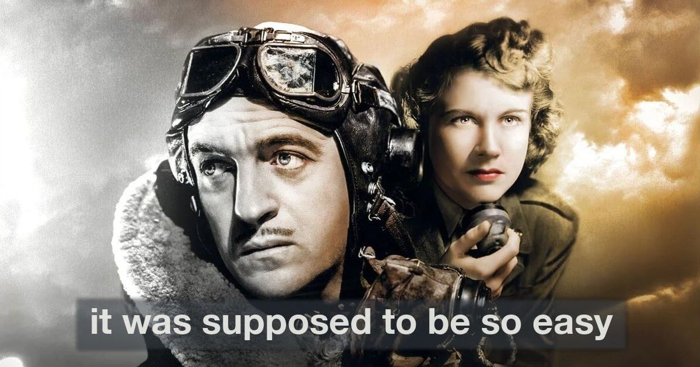
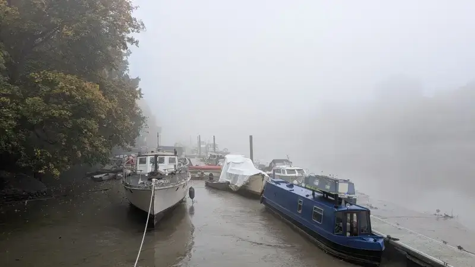
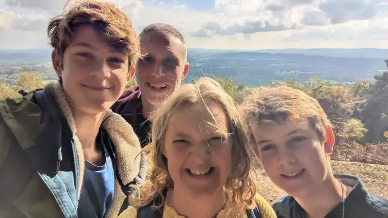

Cobblers. It wasn't. 

There's a classic film called "*A Matter of Life and Death*". It was made before I was born. Before my parents were born. At the start you see Squadron Leader Peter Carter flying a damaged Lancaster bomber back to England. He thinks he's going to die, and before he dies, he has a final conversation over the radio with a lady named June. He bails out of the plane, and believes that will be it. He's falling to his death.

By the way, Peter and June fell in love in that short radio chat. It's beautiful. I love it. 

{/*truncate*/}

I resonate with Peter's situation, before he calls it and jumps. I am a pilot in a plane heading for home, taking fire from enemies in the sky and below. Still flying. Still airborne. But looking at the wings and the fuselage with concern. Tapping the instruments and hoping they keep responding long enough to get me on the ground.

For the purposes of this analogy, you are June. If you haven't watched that movie, you should. 

## How am I?

Technically, things are going well. I mean, I do have cancer. That isn't so great. But when we look past that, and to how my treatment is going. Well that's been pretty promising so far.

[The summer operation, whilst painful, was a success](../2026-08-25-take-my-breath-away/index.md). My second round of chemotherapy is going straightforwardly (ish). My next operation is scheduled for the new year, and there is optimism that that could be the end of significant treatment. No guarantees; there are no guarantees possible. However, a good outcome, that's what the medics call it, remains a possibility. 

I know this. But.

For some reason I find it hard to translate that head knowledge into something I feel and believe in my gut. I lack peace. I am short on contentment.

When my eldest boy Benjamin went to nursery, they taught him basic signing. So he could express with hand movements thoughts and feelings. The one that comes to mind now is the "I sad" sign that he would make when he wasn't so jolly.  He'd put his hand next to his mouth and bow his head. "I sad". That's me right now. I sad.

I'm also angry. I don't want to be in this situation and I'm furious that I am. The ritual trauma of treatment is getting on my wick. I find myself lashing out. At times I've said unkind things to my wife and to my children. Things they didn't deserve and I'm not proud of.

As I walk around, I see people smoking. My instinctive reaction every time is to internally shout "stop smoking you pillock - smoking gives you cancer and I've got cancer and I hate it".

The irony is that I didn't get cancer from smoking. If I had a hand in the cause, and quite possibly I didn't, it was most likely eating processed meat. But whilst there's no shortage of smokers on the streets, there's only so many folk that can be spotted wolfing down a Peparami.

## Harder than you think

When I last wrote, I was about to start the chemotherapy again. I knew it was not going to be fun. To be more accurate, I knew it was going to be horrible. The plus side was it was going to be a horrible of a size, shape and colour that I understood.

That should make it easier, right? Wrong. I'm finding it surprisingly hard. 

I've done this before. The blood tests. The chemotherapy. The targeted therapy. The being connected up to a chemical pump for three days out of every fourteen. The pills to manage side effects. The side effects of the pills that manage side effects. Food tasting crap. A bad taste at the back of the throat that persists and denies me the pleasure of coffee in the way I normally appreciate it. Hiccups that hurt and don't quit. Acne like a teenager. A permanent rash on my shoulders and chest. Fragile skin on my hands and feet that tears open at a moments notice. Blisters and bleeding fingers. That smell. That chemical smell that won't dissipate. It leaches out of me and infects my clothes and my bedding. My clothes are washed separately to minimise my chemical sharing with the rest of the family. This all suuuuuuuucks. 

It can get you down. It's got me down. Can you tell?

That's the physical side. There is a mental side as well. Bluntly, I do not feel like me. My thoughts are subtly different. The way I normally feel each day isn't the same. Which is.... Just weird. 

The way I feel each day informs my identity. I'm sure that's true of you too. What I feel is part of what makes me, me. So who am I this week? I'm someone a bit like that John Reilly character. But I'm not him. I know that, because I like John Reilly much more. I dig that guy. This guy, me right now, I'm really not so keen. You shouldn't be either; it's a real downgrade frankly. I'd give me a 2/10 for company and general joyfulness.

I lack perspective. I don't trust my own judgement. Or I trust it enough to sense that it's off. I might seem composed externally. Inside I'm a whirlwind of uncertainty, doubt and disappointment. How did I end up here? This wasn't supposed to happen.

It's funny. When I've written in the past I think I've been more positive and more useful. Positive mental attitude and all that. I can't do it right now. I feel like I'm letting you all down, but I can't be cheery today. I can be honest with you. That's still useful. Maybe less useful. I'm not sure.

I will tell you this: I'm not going to let myself stay like this forever. I haven't worked out my way out, but there is one and I'll find it. I will. I know me.

## If you're going through hell...

... Keep going. Supposedly Winston Churchill said this, so we can be almost certain that he didn't.  Such are the number of witticisms attributed to the man.

A friend gifted me a similar sentiment: "the only way out is through". I looked it up, it seems it comes from a poem by the American First World War poet Robert Frost. In "A Servant to Servants" he says:

> He says the best way out is always through.
>
> And I agree to that, or in so far
>
> As that I can see no way out but through 

That feels like my situation. I can't do anything other than keep going. As grumpy as I am, I think I actually have some good habits in place for this difficult time. Habits which are keeping my head in as good a place as I can probably manage.

I'm working. I never gave up working. I should say that I'm not being forced to work - I want to. It gives me purpose and people with purpose do better. They can thrive. So for now I'm a remote employee of Investec. Alas I'm not physically with my colleagues and friends. But I'm there virtually, as much as I can manage. It's not what I would prefer, but COVID taught us this is indeed something. It's far, far better than nothing. More than the companionship, feeling useful helps me. I still get to make a difference. I still build things (or get AI to build things on my behalf). I still talk to people. I still post jokes in chats. People's appreciative emojis are a welcome optional extra. I'm still here. Working has lifted my spirits and distracted me.

Outside of work, I've kept on keeping on working on open source software, as I have for many years. I'm not the most productive cat out there, but I'm still shipping. It's fun, it distracts me, and, again, it makes me feel useful. Purpose!

I mentioned in an earlier post that, courtesy of friend and vicar Thomas at my church, [I have a personal Communion about every other week](../2026-06-28-a-private-lockdown/index.md#communion), give or take. I can't be in church when everyone else is there. Too much breathing and potential for germ sharing. (My gym membership is suspended for similar reasons, with added sweat.) A chat with Thomas and taking bread and wine brings me some level of peace. Due to my diagnosis I've followed the medical advice of avoiding alcohol. There's been no beer or wine since March. Jesus's blood is the one exception I have allowed myself to this rule. Interestingly I haven't yet managed to take Communion without weeping. I don't really know why. I've decided that when at some point I manage to not cry, it probably represents some kind of progress. Or maybe it just means I'm taking it more seriously than ever before. Who knows. 

I walk regularly with friends and family. That is my social life. People send me a note and say "fancy a walk?" I say: yes! As long as I'm not having treatment, I'll get out there and I will walk and talk and feel glad of the company. Today I walked 28,000 steps, much of that with a friend. We climbed up Richmond Hill and looked out over the view. They made me laugh. We talked. This feeds my soul.

Speaking of walking, each morning I get out there and see the sunrise. I go down to the river and I take a photograph of the dawn at Hammertons Ferry Terminal. It is how I start my day. 

This is a picture I took recently, on a misty morning. See how much you cannot see. 

The river, the island, the hill, the sun. You would not think they exist. Only what is directly in front of you is visible. This feels like an expression of my life right now. All those good things are still there. Still in front of me. But I'm finding it hard to see them. 

It's autumn. The nights are drawing in. The lack of light makes things feel less possible. There's a correlation between sunlight and hope. Light brings hope. Less light, less hope. So it makes sense autumn, and presumably the winter that is coming, are harder.

"Get me through this God". I've muttered that prayer again and again. My recovery in this life is quite possible. Even likely. But I don't want to presume. And with each day that is hard, I feel the need to reach out for help.  

I suspect I have received help that I haven't really acknowledged. As I go in for treatment, the doctors ask about my energy levels. Many people in my position are floored. Lying in bed, feeling incapable of more. That's not my story. I'm grumpy. Maybe I should notice my energy and be celebrating. They say the secret to happiness is managed expectations. Maybe having cancer treatment and merely being irked is actually a tremendous performance. Be proud John!

Salvatore, one of the nurses who comes to disconnect me after treatment, told me about patients that he never stops visiting. They're terminal. They do chemotherapy until it doesn't work anymore. Imagine that. I'm expecting to do 12 rounds. Then stop for a break before surgery. I might be done then. Or I may have some more. But I'm expecting for treatment to have an ending sooner or later. You see, I must remember that it could be so much worse. Limited sympathy permitted.

## It's good

Like everyone, I go through ups and downs. But my average state is contentment. I think that's true. I'm usually a happy boy. Grateful for my blessings. Able to acknowledge my good fortune. That's me. But right now it's not quite the case. I don't love that. It should change back once I've got through this. But, in the moment, it's hard to deal with. 

Let me change the record. Let me state facts, even if I struggle to treat them as such.

We often don't appreciate what we have. We notice pain, we notice inconvenience. We don't notice the good stuff. You, the person reading this: my June, I don't know what your situation is. But there is so much goodness in your life and I implore you to notice it and appreciate it. 

Food. It's good. Weather. It's good. Work. It's good. Friendship. It's good. God: good. The sun. It's good. Children. They're wonderful. Good health. That's better than I ever appreciated. 

"At least you've got your health." I used to be puzzled when people said that. I get it now. 

This is a photograph from a walk with the family. It was the last day before autumn properly started feeling like autumn. It was lovely. It was a joy. It brought me life.

Get out there. Life is good, and if you get out there you'll see it. Maybe just for a moment. We can live on moments.

Every now and then I see how good life is. Not enough right now. But I will keep looking. And occasionally I will see. I will. Even if I find that hard to believe, it is true.

At the start of this I mentioned "*A Matter of Life and Death*". A magnificent movie. Whether you identify with Squadron Leader Peter Carter or not, you should watch it. And spoilers be damned, Peter lives. As I hope to.

---

<RecoveryDiaries />
